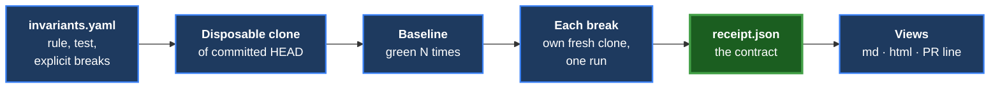
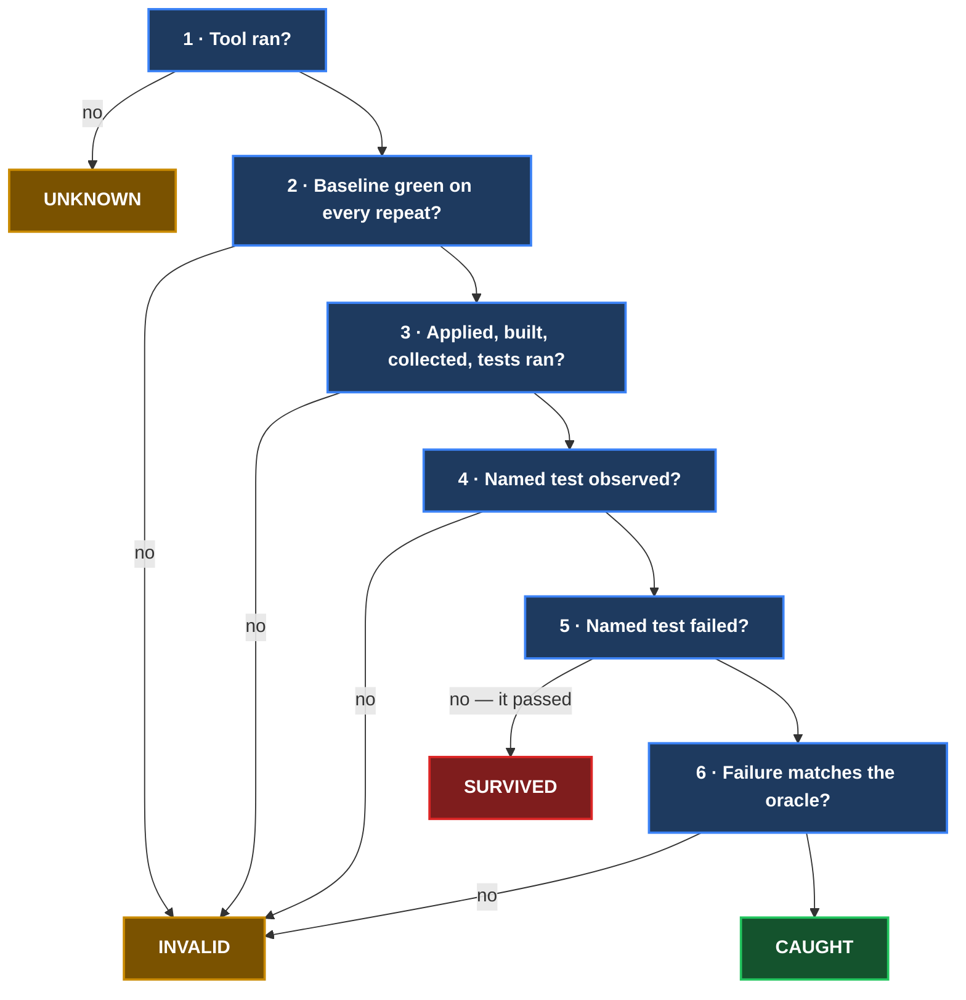

# Invariant Receipt

[](https://github.com/tom2025b/invariant-receipt/actions/workflows/ci.yml)

> Your test is green. Want a receipt showing it can turn red?

Invariant Receipt breaks your code on purpose — in exactly the ways you
describe — on a disposable copy of your repository, runs the one test you
name, and writes a receipt: the rule protected, the exact break, whether the
named test was seen failing for the declared reason, and every piece of
evidence behind that answer. The spec is
[`design-docs/2026-09-28-invariant-receipt-v1-spec.md`](design-docs/2026-09-28-invariant-receipt-v1-spec.md).

Unlike `mutmut` or `cargo-mutants`, this is not a mutation-coverage score or an
automatic search for weak tests. It is a proof of one specific rule: for each
explicit break you declare, did the one named test fail for the declared reason?



## Use

```
invariant-receipt run inv.yaml               # every invariant
invariant-receipt run inv.yaml --repeat 3    # baseline 3x (mutations always run once)
invariant-receipt run inv.yaml --only NAME   # one invariant (repeatable)
invariant-receipt validate inv.yaml          # preflight authoring; applies no mutation
invariant-receipt render receipts/           # rebuild the views from the JSON
invariant-receipt --version
```

Other `run` options: `--timeout S` (each build and each run, default 600),
`--out DIR` (default `./receipts`), `--workdir DIR` (where copies go),
`--keep` (keep the copies), `--runner auto|pytest|nextest|cargo` (override),
`--python PATH` (interpreter that runs pytest).

`validate` reads the current YAML and patch files, then uses a disposable clone
of committed `HEAD` to check paths, exact-one `find` matches, patch
applicability, runner selection, and named-test discovery. It writes no receipt
and applies no mutation, so run it while authoring to catch declarations that
have drifted before paying for an evidence run.

| Outcome across all receipts | Exit |
|---|---|
| every mutation CAUGHT | 0 |
| any SURVIVED — checked first, wins over everything | 1 |
| otherwise any UNKNOWN | 3 |
| otherwise any INVALID | 2 |
| refused before testing (dirty tree, bad YAML, bad arguments) | 4 |

The decision order and process exit codes answer different questions: UNKNOWN
is checked before INVALID when classifying evidence, while exit `2` remains
INVALID and exit `3` remains UNKNOWN so automation can distinguish them.

## What you write

```yaml
invariant: duplicate-ids-are-rejected
test: tests/test_ids.py::test_rejects_duplicate_id   # pytest node id, or a Rust test path
mutations:
  - id: drop-the-check
    file: src/ids.py
    find: "if new_id in seen:"        # must match exactly once
    replace: "if False:"
    expect: {outcome: fail, matches: "duplicate"}   # matches: optional regex
  - id: overwrite-instead
    patch: mutations/overwrite.diff   # relative to this YAML; paths in it relative to the project
    expect: {outcome: fail}
```

Several invariants go under `invariants:`. Optional keys: `description`,
`project` (directory, relative to the YAML, where the runner runs), `runner`,
and for Rust `target: lib | test:NAME | bin:NAME`. Unknown keys are refused.

Because `find` must match exactly once, source edits can make a declaration go
stale; the eventual evidence run reports that mutation as INVALID. Use
`invariant-receipt validate inv.yaml` after code changes to find that drift
without applying mutations.

## A real CAUGHT receipt

This excerpt is from the checked-in pytest fixture receipt at
[`tests/data/receipt_caught.json`](tests/data/receipt_caught.json). The full JSON
also records the commit, tree hashes, commands, timings, diff, logs, and failure
excerpt.

```json
{
  "invariant": "dup-ids-two-way",
  "test": "tests/test_ids.py::test_rejects_duplicate_id",
  "mutation": {
    "id": "drop-the-check",
    "fingerprint": "sha256:4c1e20dcbf67ec11b9d317ff830534a136ab35757238a867d8d535a35a0ba51d",
    "run": {
      "named_test_observed": true,
      "named_test_result": "failed",
      "oracle_matched": true,
      "failure_signature": "sha256:ec18792d57781c5afd394bdd015309132d852ad78d079b11abfd1abad3e60eca"
    }
  },
  "verdict": "CAUGHT",
  "reason": "caught",
  "reason_detail": "the named test ran and failed as declared"
}
```

## Verdicts, in the fixed decision order



Nothing is inferred from an exit code: only the named test's own result, read
from the runner's per-test output, counts. Prefer cargo-nextest for Rust: the
`cargo test` text fallback refuses to guess, so interleaved output (for example
a test that runs another test binary) makes the run ambiguous and the named
test `INVALID: named_test_not_observed`. Per invariant the summary is GAP FOUND
(a declared break survived), TWO-WAY VERIFIED (two independent breaks were
caught through different failure locations), ONE-WAY (caught, but with only
one independent failure path), or INCOMPLETE (some evidence was not usable).
The short labels keep CI summaries compact; these definitions are the meaning
behind them.

## Safety

Every run happens in a fresh local clone of the committed HEAD — one clone per
mutation, each with its own cargo target directory. A dirty working tree is
refused. The original tree's `git status` and a hash of every tracked file are
recorded before and after; any change makes the whole run
`UNKNOWN: source_tree_changed`. Receipts stay UNKNOWN on disk until that final
check passes, so a run that dies half way never leaves an unconfirmed CAUGHT.

## Install

```
scripts/install.sh [VENV_DIR]     # default: .venv-tool; refuses a dirty tree
```

It builds from `git archive HEAD` and stamps version, commit and build time;
`--version`, every receipt's `tool` block and the HTML footer all show it.

## Development gate

```
python3 -m venv .venv && .venv/bin/pip install -e '.[dev]'   # or: pip install pytest pyyaml jsonschema ruff
.venv/bin/ruff check src tests && .venv/bin/ruff format --check src tests
.venv/bin/python -m pytest
```

The suite needs `cargo` and `cargo-nextest` (the Rust fixture runs under
both). Tests import from `src/` via pytest's `pythonpath`, never from an
install, so a mutation proof that edits a clone's `src/` is tested by that
clone. Read the pass count: `0 passed` is a failure.

Fixture projects live in `fixtures/` (a Rust crate and a Python package); the
end-to-end tests copy each into a fresh git repository and run the real tool.
Recorded real runner output for the parser tests is in `tests/data/`.

## Self-dogfooding

The repository's own [`invariants.yaml`](invariants.yaml) uses Invariant
Receipt to protect five of the tool's honesty and safety rules:

- every requested baseline repeat must pass;
- an oracle may use only the named test's own failure evidence;
- aggregate exit status must preserve the worst observed outcome;
- any change to the original tree poisons every receipt; and
- the `cargo test` fallback must retain the named failure's evidence.

Run the declarations from a clean checkout on Linux:

```
invariant-receipt run invariants.yaml --repeat 3
```

These are explicit regression proofs, not a claim of complete coverage. A new
mutation is added only when it represents a concrete way one of the declared
rules could break.

## Future milestones

These milestones describe direction, not promised dates. Each one must keep
the V1 evidence contract fail-closed: JSON remains authoritative, mutations
remain user-declared, and only the named test's observed result can earn
CAUGHT.

1. **Safer authoring.** Keep the non-mutating `validate` preflight aligned with
   the evidence runner as schemas, runners, and declaration forms evolve.
2. **Release hardening.** Run the self-dogfooding declarations in the Linux CI
   gate, make installation and version provenance reproducible, and publish a
   first tagged release with its generated artifacts.
3. **Parser resilience.** Expand the recorded-output corpus across supported
   pytest, nextest, and `cargo test` versions while preserving refusal on
   ambiguous, missing, zero-test, compile, collection, and timeout outcomes.
4. **CI and review integration.** Publish `receipt.json` as the primary CI
   artifact and derive Markdown, HTML, and concise pull-request summaries from
   that same contract without creating a second source of truth.
5. **Additional runners by evidence quality.** Consider another language only
   when its runner can identify the exact named test and preserve that test's
   own failure text as reliably as the Rust and Python implementations.
6. **Optional orchestration and views.** Explore failure-atlas, MCP, dashboard,
   or GUI integration only as consumers of receipts; they must not invent
   mutations, reinterpret verdicts, or weaken disposable-copy isolation.

## Not in V1

No automatic mutation generation, no AI, no MCP server/dashboard/GUI, no
languages beyond Rust and Python, no uncommitted-changes support, no
failure-atlas integration, and no tagged release yet.

## Security

Do not disclose suspected vulnerabilities in a public issue. Follow the
private reporting instructions in [`SECURITY.md`](SECURITY.md).

## License

Licensed under the [Apache License, Version 2.0](LICENSE).
