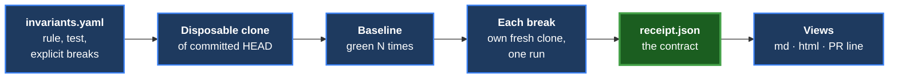
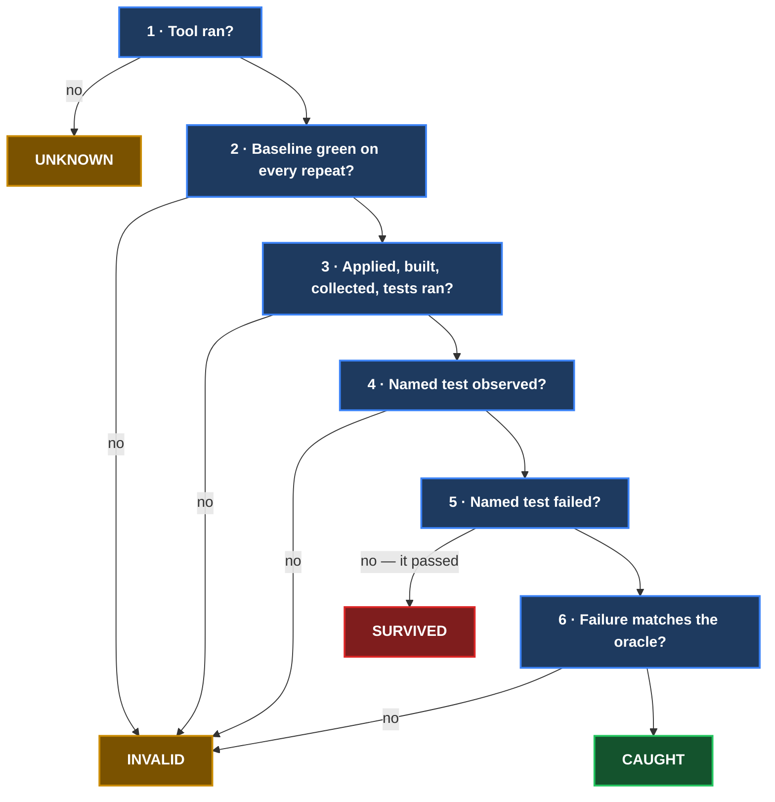

# Invariant Receipt

> Your test is green. Want a receipt showing it can turn red?

Invariant Receipt breaks your code on purpose — in exactly the ways you
describe — on a disposable copy of your repository, runs the one test you
name, and writes a receipt: the rule protected, the exact break, whether the
named test was seen failing for the declared reason, and every piece of
evidence behind that answer. The spec is
[`design-docs/2026-09-28-invariant-receipt-v1-spec.md`](design-docs/2026-09-28-invariant-receipt-v1-spec.md).



## Use

```
invariant-receipt run inv.yaml               # every invariant
invariant-receipt run inv.yaml --repeat 3    # baseline 3x (mutations always run once)
invariant-receipt run inv.yaml --only NAME   # one invariant (repeatable)
invariant-receipt render receipts/           # rebuild the views from the JSON
invariant-receipt --version
```

Other `run` options: `--timeout S` (each build and each run, default 600),
`--out DIR` (default `./receipts`), `--workdir DIR` (where copies go),
`--keep` (keep the copies), `--runner auto|pytest|nextest|cargo` (override),
`--python PATH` (interpreter that runs pytest).

| Outcome across all receipts | Exit |
|---|---|
| every mutation CAUGHT | 0 |
| any SURVIVED — checked first, wins over everything | 1 |
| otherwise any UNKNOWN | 3 |
| otherwise any INVALID | 2 |
| refused before testing (dirty tree, bad YAML, bad arguments) | 4 |

## What you write

```yaml
invariant: duplicate-ids-are-rejected
test: tests/test_ids.py::test_rejects_duplicate_id   # pytest node id, or a Rust test path
mutations:
  - id: drop-the-check
    file: src/ids.py
    find: "if new_id in seen:"        # must match exactly once
    replace: "if False:"
    expect: {outcome: fail, matches: "duplicate"}   # matches: optional regex
  - id: overwrite-instead
    patch: mutations/overwrite.diff   # relative to this YAML; paths in it relative to the project
    expect: {outcome: fail}
```

Several invariants go under `invariants:`. Optional keys: `description`,
`project` (directory, relative to the YAML, where the runner runs), `runner`,
and for Rust `target: lib | test:NAME | bin:NAME`. Unknown keys are refused.

## Verdicts, in the fixed decision order



Nothing is inferred from an exit code: only the named test's own result, read
from the runner's per-test output, counts. Per invariant the summary is
GAP FOUND, TWO-WAY VERIFIED (two catches with different mutation fingerprints
**and** different failure signatures), ONE-WAY, or INCOMPLETE.

## Safety

Every run happens in a fresh local clone of the committed HEAD — one clone per
mutation, each with its own cargo target directory. A dirty working tree is
refused. The original tree's `git status` and a hash of every tracked file are
recorded before and after; any change makes the whole run
`UNKNOWN: source_tree_changed`. Receipts stay UNKNOWN on disk until that final
check passes, so a run that dies half way never leaves an unconfirmed CAUGHT.

## Install

```
scripts/install.sh [VENV_DIR]     # default: .venv-tool; refuses a dirty tree
```

It builds from `git archive HEAD` and stamps version, commit and build time;
`--version`, every receipt's `tool` block and the HTML footer all show it.

## Development gate

```
python3 -m venv .venv && .venv/bin/pip install -e '.[dev]'   # or: pip install pytest pyyaml jsonschema ruff
.venv/bin/ruff check src tests && .venv/bin/ruff format --check src tests
CARGO_TARGET_DIR=/mnt/builds2/targets/invariant-receipt buildlock .venv/bin/python -m pytest
```

The suite needs `cargo` and `cargo-nextest` (the Rust fixture runs under
both). Tests import from `src/` via pytest's `pythonpath`, never from an
install, so a mutation proof that edits a clone's `src/` is tested by that
clone. Read the pass count: `0 passed` is a failure.

Fixture projects live in `fixtures/` (a Rust crate and a Python package); the
end-to-end tests copy each into a fresh git repository and run the real tool.
Recorded real runner output for the parser tests is in `tests/data/`.

## Not in V1

No automatic mutation generation, no AI, no MCP server/dashboard/GUI, no
languages beyond Rust and Python, no uncommitted-changes support, no
failure-atlas integration, no public release.
