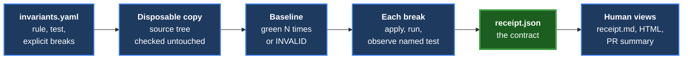
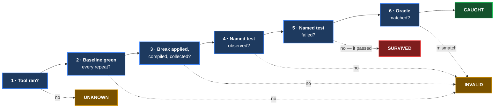

<style>
@page { size: Letter; margin: 9mm 10mm 13mm 10mm; }
.card { font-family: -apple-system, "Segoe UI", Roboto, sans-serif; }
.banner { background: #E8F5E9; border-left: 14px solid #2E7D32; padding: 10px 16px; margin-bottom: 7px; }
.banner h1 { margin: 0; font-size: 28pt; color: #1B5E20; background: none; border: none; padding: 0; }
.banner .mn { font-size: 12pt; font-weight: 700; letter-spacing: 3px; color: #2E7D32; }
.banner .ph { font-size: 11.5pt; font-style: italic; color: #1B5E20; margin-top: 2px; }
.blk { padding: 8px 14px; margin: 7px 0; }
.blk .lab { font-size: 9pt; font-weight: 700; letter-spacing: 1.5px; text-transform: uppercase; }
.blk .claim { font-size: 16pt; font-weight: 700; display: block; margin: 2px 0 4px 0; line-height: 1.18; }
.blk p { margin: 0; font-size: 11.6pt; line-height: 1.34; }
.g { background: #E8F6EC; border-left: 4mm solid #1B8A3A; } .g .lab, .g .claim { color: #0F5C26; }
.a { background: #FFF6E0; border-left: 4mm solid #C98A00; } .a .lab, .a .claim { color: #7A5200; }
.r { background: #FDEBEB; border-left: 4mm solid #C62828; } .r .lab, .r .claim { color: #8E1B1B; }
.b { background: #EAF1FD; border-left: 4mm solid #2E5FD1; } .b .lab, .b .claim { color: #1B3A80; }
.strip { background: #EFEFEF; border-left: 4mm solid #777; padding: 9px 14px; font-size: 11.5pt; margin-top: 7px; }
.pill { background: #555; color: #fff; padding: 1px 7px; border-radius: 9px; font-size: 9.5pt; font-weight: 700; }
</style>

<div class="card">
<div class="banner">
<div class="mn">RECEIPT</div>
<h1>Invariant Receipt — Version 1</h1>
<div class="ph">"Your test is green. Want a receipt showing it can turn red?"</div>
</div>

<div class="blk g">
<span class="lab">What it is</span>
<span class="claim">A tool that breaks your code on purpose, and proves the test noticed.</span>
<p>A passing test shows the code works today. It does not show the test would notice if
the code broke. Invariant Receipt makes one specific break you describe, runs the one
test you name, and writes a receipt: the rule protected, the exact break, the test that
caught it, and every piece of evidence — so a reviewer checks facts, not a claim.</p>
</div>

<div class="blk a">
<span class="lab">Why it has to be careful</span>
<span class="claim">A test that fails for the wrong reason is not a catch.</span>
<p>A build error, a test that never ran, zero tests found, a different test failing, a
timeout — each of these makes a run go red without the named test doing its job. All of
them are <b>INVALID</b>. Only the named test, seen running and failing as declared,
earns <b>CAUGHT</b>.</p>
</div>

<div class="blk b">
<span class="lab">Four answers per break, one summary per rule</span>
<span class="claim">CAUGHT, SURVIVED, INVALID, UNKNOWN — then TWO-WAY VERIFIED.</span>
<p>Each break gets its own honest verdict. A rule is <b>TWO-WAY VERIFIED</b> when two
different breaks were each caught, failing in different ways. Never "proven": two
examples do not prove every possible break, and the name says so.</p>
</div>

<div class="blk r">
<span class="lab">Where Version 1 stops</span>
<span class="claim">You name the breaks. It runs them on a copy. It writes receipts. Stop.</span>
<p>Rust and Python only. It never touches your working folder, and proves that it
didn't. No automatic break-finding, no AI, no dashboard, no MCP server.</p>
</div>

<div class="strip">
<span class="pill">STATUS</span> spec only — nothing built &nbsp;·&nbsp;
<span class="pill">NEXT</span> Tom reads, then says GO &nbsp;·&nbsp;
<span class="pill">SHAPE</span> same as Diagram Press: JSON is the contract
</div>
</div>

## 1 · The pipeline

**Invariant Receipt V1 specification · 2026-09-28 · Titan · written by max.** An
*invariant* is a rule the code must never break — "duplicate IDs are rejected", "a
blessed baseline counts the same way twice". A *mutation* is one deliberate violation
of it. For each mutation the tool proves, on a disposable copy of the repository, that
the baseline is green and stable, then that the named test turns red for the declared
reason. Everything it saw goes into the receipt.



The receipt is drawn larger for the same reason as in Diagram Press: it is the
contract. The Markdown, the HTML page, the one-line PR summary and anything built later
all read the same JSON. It is not a report written after the fact; every run writes into
it as it happens.

---

## 2 · What you give it

One YAML file per invariant (or several invariants in one file). **Mutations are always
explicit** — this tool never guesses where to break your code. That is what separates it
from cargo-mutants and Stryker, and what makes it easy to trust.

```yaml
invariant: duplicate-ids-are-rejected
description: Registering the same ID twice must fail.
runner: auto   # auto | pytest | nextest | cargo
test: tests/test_ids.py::test_rejects_duplicate_id
mutations:
  - id: drop-the-check
    file: src/ids.py
    find: "if new_id in seen:"
    replace: "if False:"
    expect:
      outcome: fail
      matches: "duplicate"      # optional
  - id: overwrite-instead
    patch: mutations/overwrite.diff
    expect:
      outcome: fail
```

- **`find` must match exactly once.** Zero or several matches is
  `INVALID: mutation_not_applied`. A patch that does not apply cleanly is the same.
- **A mutation that changes nothing** is `INVALID: mutation_no_change`.
- **`expect` is the failure oracle:** the named test must be seen failing. `matches`
  is optional, since some good tests have no stable failure text.

---

## 3 · Verdicts — per mutation

Every mutation ends in exactly one of four verdicts, each with a machine-readable
`reason`. The tool decides in a fixed order, so the same evidence always gives the same
answer.



| Verdict | Means | `reason` values |
|---|---|---|
| **CAUGHT** | The named test was observed running and failing as declared | `caught` |
| **SURVIVED** | The named test was observed and **passed** — a real gap in the test | `named_test_passed` |
| **INVALID** | The run cannot say anything about the invariant | `baseline_not_stable`, `baseline_no_tests`, `named_test_not_found`, `mutation_not_applied`, `mutation_no_change`, `compile_failed`, `collection_failed`, `zero_tests`, `named_test_not_observed`, `timeout`, `oracle_mismatch` |
| **UNKNOWN** | The tool itself could not run (runner missing, copy failed, crashed) | `runner_missing`, `copy_failed`, `internal_error` |

**Rules the table makes:**

- **Other tests failing does not matter.** The receipt is about the named test. If it
  was observed and passed while other tests failed, the verdict is SURVIVED.
- **Nothing is inferred.** "The run exited non-zero" is never evidence on its own; the
  named test's own result must be observed in the runner's output.
- **A baseline problem poisons every mutation of that invariant.** If the baseline is not
  green on every repeat, no mutation run is attempted and all are
  `INVALID: baseline_not_stable`.

---

## 4 · The invariant summary — two-way verification

Each receipt stands alone, and a single CAUGHT is an honest result. Tom's two-ways rule
lives one level up, on the invariant.

| Invariant status | When |
|---|---|
| **GAP FOUND** | Any mutation SURVIVED. Shown first, in red. |
| **TWO-WAY VERIFIED** | At least two mutations CAUGHT, with **different mutation fingerprints** and **different failure signatures** |
| **ONE-WAY** | Exactly one CAUGHT, or several CAUGHT that all failed the same way |
| **INCOMPLETE** | No CAUGHT and no SURVIVED — only INVALID or UNKNOWN |

A *failure signature* is a normalised fingerprint of the named test's failure output
(assertion location plus message, with volatile parts such as addresses, paths and
timings stripped). Two breaks that trip the same assertion with the same message are one
way, not two. The word "proven" is not used anywhere: two examples do not prove every
possible violation, and the status names say exactly what was shown.

---

## 5 · What every receipt records

The receipt holds the evidence, not just the conclusion. A reviewer can check each
field without trusting the tool.

```json
{
  "schema": "invariant-receipt/receipt/1",
  "tool": { "version": "0.1.0", "commit": "a1b2c3d" },
  "invariant": "duplicate-ids-are-rejected",
  "source": {
    "repo_commit": "9f8e7d6",
    "tree_clean_before": true,
    "tree_clean_after": true,
    "tree_hash_before": "4c1e…",
    "tree_hash_after": "4c1e…"
  },
  "runner": {
    "kind": "pytest", "parser": "junit-xml"
  },
  "baseline": {
    "command": "pytest tests/test_ids.py::…",
    "repeat": 3,
    "runs": [ { "exit": 0, "discovered": 1,
                "passed": 1, "failed": 0,
                "named_test": "passed",
                "seconds": 0.8 } ]
  },
  "mutation": {
    "id": "drop-the-check",
    "fingerprint": "sha256:5b2…",
    "applied": true, "compile": "ok",
    "run": { "exit": 1, "discovered": 1,
             "named_test_observed": true,
             "named_test_result": "failed",
             "oracle_matched": true,
             "failure_signature": "sha256:e9a…",
             "seconds": 0.9 }
  },
  "verdict": "CAUGHT",
  "reason": "named test ran and rejected the mutation"
}
```

- **Baseline and mutation are recorded separately**, each with its command, counts,
  exit code and duration.
- **`runner.parser` names which parser produced the evidence** — `junit-xml`,
  `nextest-junit`, or `cargo-text` — so a reader knows how much to trust the parsing.
- **The schema is versioned** and shipped as a JSON Schema file; tests validate every
  receipt against it. Optional fields may be added within a version; renaming or
  removing one is a new version.

---

## 6 · Runners and parsers

| Language | Preferred | Fallback | Notes |
|---|---|---|---|
| Python | `pytest` with `--junitxml` | — | Machine-readable, per-test results |
| Rust | `cargo-nextest` with JUnit output | `cargo test` text output | `cargo test`'s own JSON is nightly-only, so the fallback parses text |

- **The text parser for `cargo test` is tested against recorded real output**: passes,
  failures, panics, `should_panic`, filtered-out counts, and the `0 passed` case that
  looks like success and is not.
- **`runner: auto`** picks nextest when it is installed, otherwise `cargo test`, and
  records which one it used.
- **Test counts are always read.** A run that discovered zero tests is
  `INVALID: zero_tests`, never a pass or a catch.

---

## 7 · Safety — a copy, and proof the original was untouched

- **All runs happen in a disposable copy** made from the committed `HEAD` (a local
  clone into a temporary directory). Uncommitted changes are not part of V1: the
  receipt must name a real commit, so **a dirty working tree is refused**.
- **Before and after**, the tool records the working tree's `git status` and a hash of
  its tracked files. Both go in the receipt; if they differ, the receipt says so loudly
  and the whole run is `UNKNOWN: source_tree_changed`.
- The copy is deleted afterwards unless `--keep` is given.
- **Timeouts** apply to every run (default 10 minutes, `--timeout` to change). A timeout
  is `INVALID: timeout`, never a catch.

---

## 8 · Command line and exit codes

```
invariant-receipt run inv.yaml               # every invariant
invariant-receipt run inv.yaml --repeat 3    # baseline 3x
invariant-receipt run inv.yaml --only NAME   # one invariant
invariant-receipt render receipts/           # rebuild views
invariant-receipt --version
```

**`--repeat N` applies to the baseline only.** Each mutation runs once. Multiplying every
mutation run by N would turn V1 into a CPU furnace for no gain: a flaky *baseline*
invalidates everything, but a mutation result is read directly from its one run.

| Outcome across all receipts | Exit code |
|---|---|
| Every mutation CAUGHT | 0 |
| Any SURVIVED (a real gap) | 1 — checked first, wins over everything |
| Otherwise any UNKNOWN | 3 |
| Otherwise any INVALID | 2 |

CI should treat any non-zero code as a failure. The order puts the most important news
first: a survived mutation is a defect in the test suite, and it is never hidden behind
a less serious code.

**Outputs:** one `receipt.json` per mutation, plus `summary.json` for the invariant
statuses; `receipt.md` and a self-contained `receipt.html` for people; and a PR-sized
summary, one line per invariant, e.g.
`duplicate-ids-are-rejected — TWO-WAY VERIFIED (2/2 caught)`.

**Build identity:** as in Diagram Press, `--version`, every receipt's `tool` block and the
HTML footer agree on version, commit and build time, and install refuses a dirty tree.

---

## 9 · How V1 proves itself — fixtures

Two small sample projects live in the repo, one Rust crate and one Python package, each
with known invariants chosen to produce every verdict:

| Fixture case | Expected |
|---|---|
| A good test and a real break | CAUGHT |
| A weak test that does not check the rule | SURVIVED → invariant GAP FOUND |
| A break that stops the code compiling | INVALID: compile_failed |
| A matcher that does not match the real failure | INVALID: oracle_mismatch |
| A test that passes only some of the time | INVALID: baseline_not_stable (with `--repeat 5`) |
| A test filter that selects nothing | INVALID: zero_tests |
| Two breaks failing the same assertion the same way | ONE-WAY, not TWO-WAY |
| Two breaks failing differently | TWO-WAY VERIFIED |
| Rust via nextest and via `cargo test`, same invariant | same verdicts; `parser` field differs |

The tool's own most important rule, **"only the named test failing as declared earns
CAUGHT"**, is mutation-proven two ways through failure-atlas: once by removing the
oracle check, so a wrong-reason failure would be promoted, and once by treating a
non-zero exit as a catch.

---

## 10 · Where Version 1 stops

**V1 ends when:** explicit mutations run on a disposable checkout; baseline and mutation
evidence are recorded separately; every fixture case in §9 gives its stated verdict for
Rust (both parsers) and Python; the receipt schema is versioned and validated; the
human views render from the JSON; the two-way invariant summary works; and the source
tree is proven untouched on every run.

Not in V1 — each waits for its own decision after V1 ships:

- no automatic mutation generation of any kind
- no AI choosing or writing mutations
- no MCP server, dashboard, web service or GUI
- no languages beyond Rust and Python
- no support for uncommitted changes
- no integration with failure-atlas (a later adapter could read these receipts)
- no public release until Tom says so

---

## 11 · Decisions made in the design conversation (Tom, 2026-09-28)

1. **Four verdicts; CAUGHT needs a declared failure oracle.** The named test must be
   observed failing; a text matcher is optional because some legitimate tests have no
   stable failure text. Compile, collection, zero-test, wrong-test and timeout outcomes
   are all INVALID.
2. **Mutations are user-specified only.** V1 proves that a particular test detects
   particular violations; it does not search for violations.
3. **Two-ways lives on the invariant, not the receipt.** A single CAUGHT receipt is
   honest on its own. The invariant earns TWO-WAY VERIFIED; the word "proven" is not
   used.
4. **Rust and Python** in V1; nextest preferred for Rust with a tested `cargo test` text
   fallback; the receipt records which parser produced the evidence.
5. **Disposable copy, non-negotiable,** with the working tree verified before and after.
6. **JSON is the contract;** Markdown/HTML and the PR summary are views of it.
7. **`--repeat N` for the baseline only;** one failure is `INVALID: baseline_not_stable`
   and no mutation result is promoted to CAUGHT.

**Status: spec only. No implementation until Tom reads this and says GO.**

**Signed:** max · 2026-09-28T14:55:00-04:00
