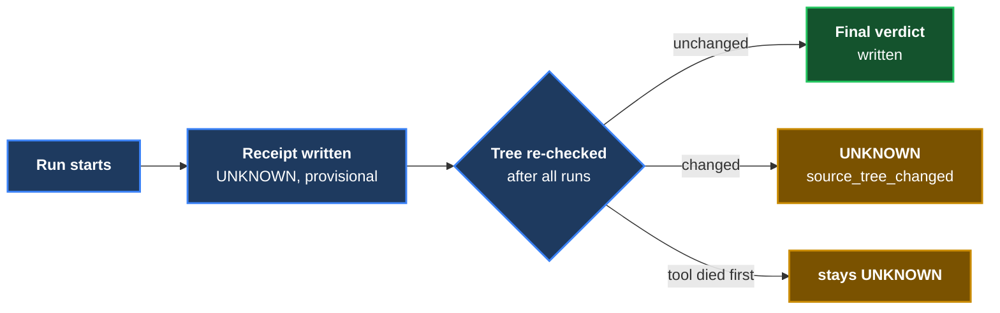

# ADR 0001 — V1 receipt contract and the honesty mechanics beyond the spec

- **Status:** Accepted (pending cross-family review of the V1 PR)
- **Date:** 2026-09-28
- **Context owner:** lane E1

## Context

The approved V1 spec (`design-docs/2026-09-28-invariant-receipt-v1-spec.md`)
fixes the verdicts, the decision order, the summary statuses and the exit
codes. Building it surfaced places where the spec was silent or where a naive
implementation would let a wrong CAUGHT through. Each decision below was taken
by the rule "when ambiguous, pick the reading that is harder to fool", and
each is expensive to reverse once receipts exist in the wild.

## Decisions

1. **Provisional receipts.** A receipt is written as soon as its mutation
   finishes, but it says `UNKNOWN / internal_error ("provisional")` until the
   after-run tree check passes. A crash or Ctrl-C therefore leaves UNKNOWN
   receipts, never an unconfirmed CAUGHT.
2. **`source_tree_changed` is an UNKNOWN reason.** The spec names it in §7
   but not in the §3 table; it is added to the UNKNOWN list.
3. **Exit code 4 = refused.** The spec gives 0/1/2/3 for outcomes. A run
   refused before anything is tested (dirty tree, bad YAML, bad arguments,
   foreign output directory) exits 4 and still writes a `summary.json` that
   says REFUSED. argparse's own usage-error code (2) is remapped, because 2
   means INVALID.
4. **One fresh clone and one cargo target dir per mutation.** Observed while
   building: two copies sharing `CARGO_TARGET_DIR` made cargo run the FIRST
   copy's mutated binary for the second copy (the artifact hash ignores the
   source path; the older mtimes looked fresh). The tool now forces
   `CARGO_TARGET_DIR=<clone>/target` whatever the caller's environment says.
5. **nextest JUnit is accepted only if stamped with this run's id.** A
   project's `.config/nextest.toml` outranks a tool config (measured), so it
   can move the store and set retries. `--retries 0` goes on the command line,
   and the JUnit file must carry the `uuid` equal to the "Nextest run ID"
   printed by this run — a stale or foreign file cannot be read as evidence.
6. **`discovered` counts tests that ran.** libtest prints an `#[ignore]`d test,
   nextest's JUnit omits it; counting only executed tests is the one definition
   both honour, so the same break gets the same verdict under either parser.
7. **Baseline reasons.** At baseline: zero tests → `baseline_no_tests`; tests
   ran but none with the exact name (or more than one) → `named_test_not_found`;
   named test red/skipped on any repeat → `baseline_not_stable`; build failure,
   collection failure and timeout keep their own reasons. At the mutation
   stage zero tests is `zero_tests`. The §9 row "a filter that selects nothing
   → zero_tests" is exercised by a mutation that renames the test; a filter
   that selects nothing at baseline is `baseline_no_tests`.
8. **`reason` is the machine code; `reason_detail` is the prose.** The §5
   example shows prose in `reason`; the §3 table shows codes. Codes win.
9. **Failure signature = normalised location + message** exactly as §4 says.
   The hashed text is stored (`failure_signature_basis`) so a reviewer sees
   what "same way" meant.

## Alternatives considered

- *Rewrite the project's nextest config to force our store.* Rejected: it
  changes the code under test's configuration (setup scripts, overrides).
- *Replace the project config with `--config-file`.* Rejected for the same
  reason; the run-id stamp gives the same guarantee without that cost.
- *Share one cargo target dir for speed.* Rejected on measured evidence (4).

## Consequences

- Rust runs rebuild each clone from scratch — slower on large projects; a
  shared, content-keyed cache is a possible later optimisation.
- Two different breaks that trip the same assertion with *different values in
  the message* count as two ways. That is what §4 says; it is flagged for Tom
  as a place a later version may want to be stricter.

**Signed:** max (lane E1) · 2026-09-28T16:45:00-04:00
