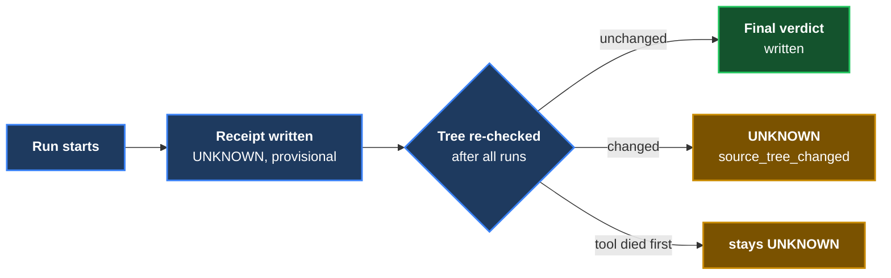

# ADR 0001 — V1 receipt contract and the honesty mechanics beyond the spec

- **Status:** Accepted (pending cross-family review of the V1 PR)
- **Date:** 2026-09-28
- **Context owner:** lane E1

## Context

The approved V1 spec (`design-docs/2026-09-28-invariant-receipt-v1-spec.md`)
fixes the verdicts, the decision order, the summary statuses and the exit
codes. Building it surfaced places where the spec was silent or where a naive
implementation would let a wrong CAUGHT through. Each decision below was taken
by the rule "when ambiguous, pick the reading that is harder to fool", and
each is expensive to reverse once receipts exist in the wild.

## Decisions

1. **Provisional receipts.** A receipt is written as soon as its mutation
   finishes, but it says `UNKNOWN / internal_error ("provisional")` until the
   after-run tree check passes. A crash or Ctrl-C therefore leaves UNKNOWN
   receipts, never an unconfirmed CAUGHT.
2. **`source_tree_changed` is an UNKNOWN reason.** The spec names it in §7
   but not in the §3 table; it is added to the UNKNOWN list.
3. **Exit code 4 = refused.** The spec gives 0/1/2/3 for outcomes. A run
   refused before anything is tested (dirty tree, bad YAML, bad arguments,
   foreign output directory) exits 4 and still writes a `summary.json` that
   says REFUSED. argparse's own usage-error code (2) is remapped, because 2
   means INVALID.
   **Confirmed by Tom 2026-09-28** and added to spec §8 as a dated amendment.
4. **One fresh clone and one cargo target dir per mutation.** Observed while
   building: two copies sharing `CARGO_TARGET_DIR` made cargo run the FIRST
   copy's mutated binary for the second copy (the artifact hash ignores the
   source path; the older mtimes looked fresh). The tool now forces
   `CARGO_TARGET_DIR=<clone>/target` whatever the caller's environment says.
5. **nextest JUnit is accepted only if stamped with this run's id.** A
   project's `.config/nextest.toml` outranks a tool config (measured), so it
   can move the store and set retries. `--retries 0` goes on the command line,
   and the JUnit file must carry the `uuid` equal to the "Nextest run ID"
   printed by this run — a stale or foreign file cannot be read as evidence.
6. **`discovered` counts tests that ran.** libtest prints an `#[ignore]`d test,
   nextest's JUnit omits it; counting only executed tests is the one definition
   both honour, so the same break gets the same verdict under either parser.
7. **Baseline reasons.** At baseline: zero tests → `baseline_no_tests`; tests
   ran but none with the exact name (or more than one) → `named_test_not_found`;
   named test red/skipped on any repeat → `baseline_not_stable`; **any other
   test in the run failed/errored, or the runner exited non-zero, on any repeat
   → `baseline_not_stable`** (the whole baseline run must be green — added after
   the Codex review of PR #1, finding 2; a red sibling had let a later failure of
   the named test be credited as CAUGHT); build failure,
   collection failure and timeout keep their own reasons. At the mutation
   stage zero tests is `zero_tests`. The §9 row "a filter that selects nothing
   → zero_tests" is exercised by a mutation that renames the test; a filter
   that selects nothing at baseline is `baseline_no_tests`.
8. **`reason` is the machine code; `reason_detail` is the prose.** The §5
   example shows prose in `reason`; the §3 table shows codes. Codes win.
9. **Failure signature = named test + WHERE the failure fired** — *superseded
   2026-09-28 by Tom's decision; the first build used location + message.* The
   basis is the normalised `file:line` of the failing assertion/panic, not the
   message: two breaks that trip the same assertion are ONE-WAY whatever values
   their messages print. With no location in the runner's output, the fallback
   is the message with every digit, hex value and quoted value stripped. The
   receipt records `failure_signature_kind` (`location` | `message-normalised`)
   and the hashed text (`failure_signature_basis`). Spec §4 amended.
10. **Locations are expressed in the unmutated file's line numbers.** Found
   while implementing 9: a Rust mutation that inserts one line vs two lines
   above the unit-test module moved the same `assert_eq!` from line 91 to 92,
   and raw `file:line` called that two ways. The mutation's own diff maps each
   location back to the original numbering; a failure inside lines the
   mutation inserted is named as such.

11. **Captured output is never harness evidence** (Codex review, finding 1).
   The cargo-text parser takes results only from the N lines libtest prints
   right after `running N tests`, and skips a failing test's captured output as
   one region, ending at the closing `failures:` list that names exactly this
   block's failed tests. A test that prints a nested `cargo test` log can no
   longer invent a result for a test that does not exist. Residual: a test
   whose captured output reproduces the closing list with the same failed
   names, or a test that writes past the capture (a child process on the
   inherited stdout), can still confuse text parsing; the summary-count
   cross-check turns most such confusion into UNKNOWN. nextest's per-test
   JUnit does not have this exposure.
12. **Diff hunks are consumed by count** (Codex review, finding 3). A body
   line such as `--- old` (a deleted `-- old`) is content, not a file header.
13. **Every exit path leaves durable evidence and no traceback** (Codex
   review, findings 4–5). A `run` whose arguments do not parse still empties
   the tool's output directory and writes a REFUSED summary (exit 4). A
   failure while rendering the views, after receipts are final, rewrites every
   receipt as `UNKNOWN: internal_error` (earlier verdict kept in the detail)
   and writes a summary (exit 3).

14. **cargo-text is a fallback that refuses ambiguity rather than guessing**
   (Codex re-check of PR #1 at `b9e6108`). A sibling test that runs a child
   test binary with ordinary `Command::status()` sends the child's whole
   harness block to the inherited stdout, inside the parent's block; the
   parser used to accept the child's `test t ... FAILED` although the parent's
   own `test t ... ok` followed, and `decide()` said CAUGHT for a test that
   passed. Now any structural surprise makes the run's harness output
   *ambiguous*: a second `running N tests` before a block's summary (in the
   result lines or the failures section), a block that stops early, a block
   whose per-test lines do not reconcile with its own summary, a duplicate or
   stray result line, or a failures section without its closing list. An
   ambiguous run gives **no result for any test**; the named test is
   `INVALID: named_test_not_observed` (detail `ambiguous_harness_output: …`)
   at the mutation stage and `baseline_not_stable` at baseline. The per-test
   lines read before the surprise stay in the receipt as evidence. Count
   reconciliation also makes the named test's result consistent with its
   block's summary by construction. **nextest remains the preferred runner**
   (`runner: auto` picks it): it runs every test in its own process and
   reports per test in JUnit, so a child's output is attributed to the test
   that ran it. This supersedes the "residual risk" paragraph of decision 11
   for the inherited-stdout case; the forged-closing-list case remains a
   residual risk that now also ends in ambiguity whenever counts disagree.

## Alternatives considered

- *Rewrite the project's nextest config to force our store.* Rejected: it
  changes the code under test's configuration (setup scripts, overrides).
- *Replace the project config with `--config-file`.* Rejected for the same
  reason; the run-id stamp gives the same guarantee without that cost.
- *Share one cargo target dir for speed.* Rejected on measured evidence (4).

## Consequences

- Rust runs rebuild each clone from scratch — slower on large projects; a
  shared, content-keyed cache is a possible later optimisation.
- Two breaks that trip the same assertion with *different values in the
  message* now count as ONE way (decision 9, Tom 2026-09-28), proven by the
  `same-assertion-different-values` fixture in both languages.
- `failure_signature_kind` was added to `receipt/1` as a required run field.
  No V1 receipt had been published, so this is not treated as a version bump.

**Signed:** max (lane E1) · 2026-09-28T16:45:00-04:00
**Amended:** max (lane E1) · 2026-09-28T17:20:00-04:00 — decisions 3 and 9 confirmed/changed by Tom; decision 10 added
**Amended:** max (lane E1) · 2026-09-28T18:10:00-04:00 — repair cycle 1 after the Codex review: decision 7 tightened, decisions 11–13 added
**Amended:** max (lane E1) · 2026-09-28T19:10:00-04:00 — repair cycle 2: decision 14 added
